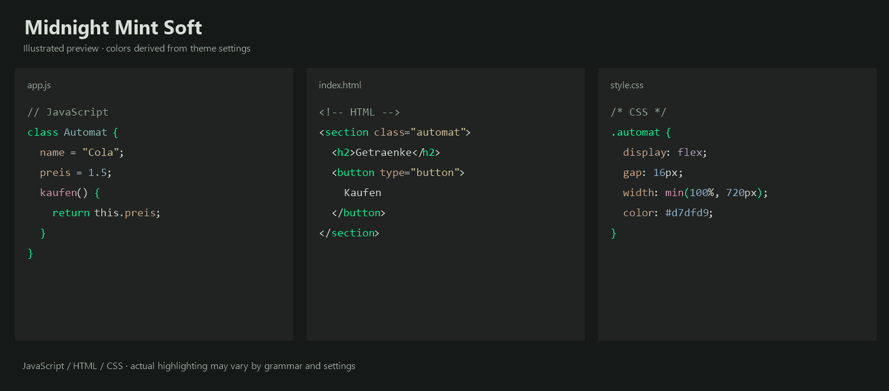
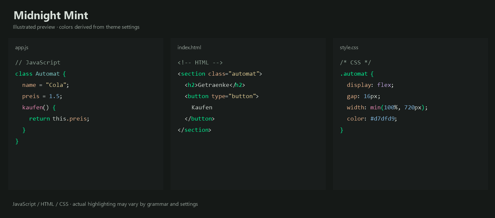
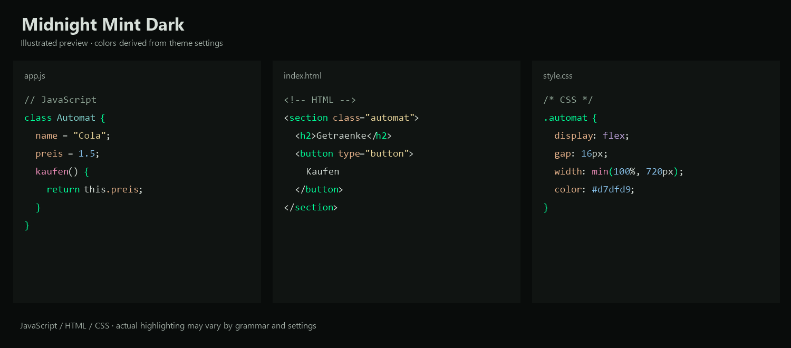

# Midnight Theme Studio

Illustrated previews use colors from the theme files; actual highlighting may vary by language and settings.

**Midnight Mint Soft**

**Midnight Mint**

**Midnight Mint Dark**

Three dark Visual Studio Code themes with signature mint accents and distinct, balanced syntax colors.

- **Midnight Mint Soft** uses gentler complementary colors and a slightly lighter editor background.
- **Midnight Mint** combines mint with turquoise, apricot, warm yellow, blue, lavender, and rose.
- **Midnight Mint Dark** uses the Midnight Mint syntax palette with darker interface surfaces.

Keywords, HTML tags, and CSS selectors use mint; classes use turquoise, properties use apricot, strings use warm yellow, and functions use rose. Exact colors vary between variants and depend on language grammars, semantic highlighting, and personal overrides.

## Activate a theme

Install the extension, open the Command Palette, run **Preferences: Color Theme**, and choose one of the three Midnight Mint variants.

## Customization

Override colors with VS Code's workbench, TextMate, or semantic token color customization settings. Existing overrides may affect the appearance.

## Develop and package

Run `npm ci` to install dependencies and `npm run package` to create a VSIX. Keep the extension name and publisher unchanged for Marketplace updates.

## Credits

Created by **Marcimoto**. Baseline colors and TextMate rules include material from Microsoft Visual Studio Code; see `THIRD-PARTY-NOTICES.txt`. The icon and Marcimoto branding are excluded from the theme's MIT license; see `LICENSE.txt`.
